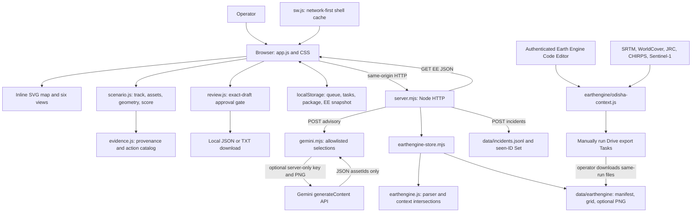

# CycloneShield AI: project deep dive, judging guide and demo rehearsal

**Repository inspection: 30 September 2026.** This guide describes the actual checked-out code and running UI, not an intended future product. Only this documentation is being added for the mentoring task; application functionality and dependencies are unchanged.

## Read this first: what you can honestly claim today

CycloneShield AI is a **scenario-based preparedness and geospatial context-screening prototype**. It demonstrates how an operator can connect a hazard footprint to fictional infrastructure, inspect an explainable indicator, choose preparedness checks and review a localized advisory. It does **not** predict cyclones or issue official alerts.

| Evidence inspected | Actual finding |
| --- | --- |
| Local architecture | Plain browser ES modules, inline SVG, CSS, Node.js built-in HTTP server; no React, Express, Leaflet, Mapbox, database dependency or compilation pipeline |
| Executable checks | `npm test`: **16/16 passed**; `npm run build` and `npm run lint`: passed JavaScript syntax checks |
| Runtime Earth Engine status | `/api/earthengine`: `unavailable`, reason **exports absent**, revision `none`; UI toggle disabled |
| Earth Engine implementation | Code Editor exporter, import validation, context calculations and rendering code exist; tests use explicit artificial fixtures; no authenticated Earth Engine run or genuine exported measurements were verified |
| Running server Gemini status | `/api/status`: key not configured in that process; model `gemini-2.5-flash` |
| Local configuration inspected safely | `.env` exists, key presence is true, model is `gemini-3.7-flash`; no key value was printed or copied |
| Configuration discrepancy | A running process does not reload a changed `.env`. Its configuration differs from the file a future startup would load |
| Model metadata check | `npm run check:gemini` failed to verify account access; its generic error does not distinguish credentials, model access or connectivity |
| Browser verification in this inspection | H01 at +18h displayed `35 + 45 + 20 = 100`; local advisory generated; download disabled → enabled by review → disabled by editing; CycloneLink controls and explicit MANET limitation visible |
| Live meteorology, public dispatch, Firebase, MANET | Not implemented |

The demo-safe sentence is: **“The software workflow works; the current screen uses labeled synthetic scenario data. Real Earth Engine context requires an authenticated export, and live Gemini access is not yet verified.”**

Do not confuse four levels of evidence: source code exists; local tests pass; an external service successfully responds; the scientific method is validated. They are different achievements.

### Navigation

1. [Problem and solution](#1-problem-and-solution)
2. [Architecture and execution paths](#2-architecture-and-execution-paths)
3. [Feature-by-feature learning guide](#3-feature-by-feature-learning-guide)
4. [Core technical explanations](#4-core-technical-explanations)
5. [Three-minute video plan](#5-three-minute-video-plan)
6. [Thirty-two judge questions](#6-thirty-two-judge-questions)
7. [File guide and reading order](#7-file-guide-and-reading-order)
8. [Requirements, discrepancies and highest-impact gaps](#8-requirements-discrepancies-and-highest-impact-gaps)
9. [Glossary](#9-glossary)
10. [Cheat sheet and rehearsal](#10-cheat-sheet-and-rehearsal)

## 1. Problem and solution

### The real problem

The challenge combines cyclone track information, rainfall/surge scenarios, infrastructure exposure, preparedness recommendations and localized early-warning drafts. A weather number alone does not explain which facility merits a readiness check, why that facility is highlighted, or what can still be accessed during a connection failure.

Anticipatory preparedness means checking supplies, shelter arrangements and service continuity **before** disruption. CycloneShield demonstrates that planning workflow. It does not establish that any hospital is damaged, any shelter is open or any route is safe.

The intended users are disaster-management authorities, municipal officials, responders and community coordinators. Those are target users, not proven deployments. There is no account system or authority-specific authorization in this repository.

### How the operator uses it

Select the fictional CS-01 time, inspect rainfall and surge footprints, click a fictional asset, read its indicator components, and inspect suggested checks. If genuine Earth Engine exports have been installed, inspect historical grid context separately. Draft in English, Odia or Hindi, edit, acknowledge review, then download a text file. CycloneLink preserves cached exercise material and queues reports for this local demo server.

The differentiation from a basic weather dashboard is the **traceable hazard → asset → reason → preparedness → reviewed communication workflow**, not better meteorological accuracy.

### A 30-second introduction to memorize

> “CycloneShield AI helps coastal planners turn hazard information into understandable preparedness actions. In our Paradip exercise, users explore a cyclone scenario, inspect fictional infrastructure and see exactly why an asset is highlighted. We support imported historical Earth Engine context and tightly constrained Gemini-assisted advisory assembly. The app also retains exercise guidance offline. This is a transparent planning prototype, not an official forecasting or warning system.”

## 2. Architecture and execution paths

### Architecture diagram



There is **no direct browser-to-Gemini request**, **no running Earth Engine SDK in Node**, and **no direct Earth Engine server authentication**. The Earth Engine path is a deliberate file handoff. The same JavaScript geometry functions run in browser and server contexts.

### Entry points and state

- `package.json` starts `node --env-file-if-exists=.env server.mjs`. Node loads optional environment variables before evaluating the module. `npm run dev` adds Node watch mode.
- `server.mjs` resolves paths relative to itself, reads existing incident IDs and creates `http.createServer`. It calls `listen` only when executed as the entry point. Tests can import `server` and bind a temporary port.
- `/` serves `public/index.html`. That page loads `style.css` and `app.js` as a module.
- `app.js` owns a mutable `state` object: view, timeline step, layers, selected asset/cell, zoom, language, draft, review state, imported context revision, queue and checklist. `render()` replaces the app HTML; `bind()` attaches current handlers again.
- There is no React virtual DOM or router. The six views are conditional render branches in `overview()` and `detail()`. Navigation normally changes state, not separate page URLs.
- The scenario selector has **one option**, CS-01. It is not a multi-scenario catalog. The time selector really changes calculations.

### Backend route inventory

| Method and path | Actual work | Important boundary |
| --- | --- | --- |
| `GET /` and public files | Reads files under `public/`; sets MIME and security headers | No static access to `.env` or the private data directory |
| `GET /api/status` | Reports process Gemini configuration, model, EE availability and explicit unimplemented integrations | Configuration presence is not a successful provider connection |
| `GET /api/earthengine` | Calls `loadEarthEngine`; returns normalized bundle, revision, availability and preview flag | Does not contact Google Earth Engine |
| `GET /api/earthengine/preview` | Returns eligible locally installed PNG, or 404 | Fixed filename, ≤1 MB, PNG signature check; not authenticity verification |
| `POST /api/advisory` | Validates language/step, reloads EE files, checks supplied context revision, calls `draftAdvisory` | Server reconstructs numerical facts rather than trusting client risk values |
| `POST /api/incidents` | Validates exercise report, deduplicates UUID, appends a JSON line | Receives locally only; no responder dispatch |

Unknown API paths return 404. Unsupported static methods return 405. Invalid or failed request processing normally returns 400. Advisory context mismatch returns 409. API responses use `Cache-Control: no-store`.

### Workflow 1: startup to dashboard

1. Run `npm start`; Node loads `.env` if present.
2. `server.mjs` reads `data/incidents.jsonl` if it exists and reconstructs `seen`, a Set of report IDs. Missing file is acceptable; malformed existing JSON is not silently repaired.
3. Browser requests `/`, then native modules and CSS.
4. `app.js` reads device state via `read()`. The starting step comes from `cs-latest.scenario.step`, or defaults to 3 (+18h). A prior saved package explains why your screen may start elsewhere.
5. `render()` calls `scenario(state.step)`, receiving polygons, input values and 12 asset rows with overlap/score fields.
6. `map()` converts longitudes/latitudes into SVG coordinates. `overview()` renders map and intelligence; `sourceStamp()` renders authored-source labels.
7. The browser registers `sw.js`. Installation attempts to cache the entire listed shell. This first fetch must complete successfully for dependable offline use.
8. `refreshEarthEngine()` calls `/api/earthengine`. Valid exports are parsed again in the browser; absent exports show explicit fallback and disable the EE checkbox.

**What moves:** HTTP files → browser modules → shared scenario object → SVG/HTML. Separately, validated local export JSON may flow server → browser. **What the user sees now:** a usable scenario, fictional asset markers, synthetic labels and “Earth Engine: synthetic fallback.”

### Workflow 2: Earth Engine data to grid and asset evidence

1. The operator authenticates in the Code Editor and runs `earthengine/odisha-context.js`.
2. `CONFIG` defines a small rectangle and date windows. `ee.Image`/`ee.ImageCollection` objects create deferred computations. Metadata `.evaluate()` callbacks decide whether a SAR comparison is eligible.
3. `buildExports()` constructs cell summaries and a manifest, then creates Drive tasks. The operator must separately start the tasks and wait for completion.
4. Copy same-run `grid.geojson` and `manifest.geojson` into `data/earthengine/`. Optional `preview.png` is downloaded from the script's thumbnail URL; a GeoTIFF cannot simply be renamed PNG.
5. `loadEarthEngine()` reads fixed filenames, imposes file-size limits and calls `parseEarthEngine()`.
6. The parser checks schema, required datasets, dates, availability flags, bounded finite values, grid geometry and matching bundle IDs. It normalizes accepted fields. The loader computes a SHA-256 revision over normalized data plus optional preview bytes.
7. Clicking “Check exported data” or “Reload exported data” calls `refreshEarthEngine()`. A changed revision clears the draft/review state. A successful import is saved in `cs-earthengine` for offline use.
8. The EE checkbox controls `eeMapLayer()`. It adds actual exported grid geometry to the existing SVG projection. `mapFrame()` expands the viewport if necessary.
9. Clicking a cell sets `selectedCell`; `eeCellEvidence()` displays its statistics. Clicking an asset calls `assetContext()`, which intersects that asset with grid cells using `exposed()`.

**What moves:** public source rasters → EE cell summary GeoJSON + manifest → private local files → validated API JSON → SVG cells and context panels. **Current verification limit:** steps 1–4 have not produced genuine exports in this repository; steps 5–9 have parser/renderer/calculation tests using artificial fixtures, not a real-data browser demonstration.

### Workflow 3: generate, review and export an advisory

1. In Advisories, choose a language and press “Generate advisory draft.” `generate()` stops animation, records step/language and advances `draftRequest`.
2. Browser POSTs `{step, language, contextRevision}`. No API key or client-calculated score is sent.
3. Server rejects an unsupported language, non-integer step or step outside 0–6. It reloads EE data. If the supplied revision differs, it responds 409; the frontend refreshes context and asks for a new draft.
4. `draftAdvisory()` calls `scenario(step)` and `priorityActions()`. Default selection is the first three exposed assets sorted by score, then ID.
5. If a key exists, Gemini receives those eligible actions, unknowns, provenance and optional computed grid context/eligible PNG. `validateSelection()` accepts only 1–3 unique allowlisted IDs in the exact JSON object shape.
6. Any failed, incomplete or unsupported model output falls back. `composeAdvisory()` supplies authored localized text; `contextAppendix()` adds deterministic historical facts when data exists.
7. Browser sets the draft and clears approval. A browser network failure instead uses `composeAdvisory()` locally; its context appendix defaults to all assets, whereas the server appendix uses selected IDs.
8. Editing calls `invalidateReview()`. Checking review calls `approveReview()`, which binds approval to `reviewKey(state)`.
9. `canExport()` compares the current key to the stored approval token. `reviewedExport()` refuses unapproved text and adds an exercise/source wrapper. `download()` uses a Blob URL to download a local TXT file.

**Important:** the review token is an exact-state string, not a digital signature or authenticated officer approval. The exported file is not a public dispatch.

## 3. Feature-by-feature learning guide

Each card answers what, why, implementation, data, missing-data behavior, screen demonstration and both judging levels.

### 3.1 Interactive schematic map and layers

- **What / why:** A visual planning surface connects footprints to asset locations so operators can inspect the reason for a highlight.
- **Implementation:** `app.js`: `xy()`, `path()`, `map()`, `mapFrame()`, `bind()`. Inline SVG paths, circles and text; no map library or remote tiles. `xy()` uses a linear longitude/latitude mapping into a 900×650 reference frame.
- **Inputs → outputs:** scenario polygons, track, assets, toggles and optional exported grid → SVG elements. Point markers and grid cells have keyboard handlers; zoom changes the SVG group transform.
- **Missing data:** authored geometry is bundled. EE toggle is disabled without valid exports. No network map service is required.
- **Demonstrate:** toggle rainfall and surge separately; click H01; zoom/reset. Explain that hiding a layer changes visibility, not exposure calculations.
- **Non-technical:** “You can inspect which example assets sit inside each planning footprint.”
- **Technical:** “Small-area coordinate geometry renders directly as SVG; it is not a surveyed basemap, a routing engine or a slippy-tile GIS.”
- **Status:** implemented/tested synthetic visualization; imported overlay is conditional and real-data unverified.

### 3.2 Cyclone track and animated timeline

- **What / why:** Seven positions and seven time steps illustrate evolving preparedness priorities.
- **Implementation:** `scenario.js: track, scenario`; `app.js: timeline, changeStep`, the play handler and a 1,800 ms interval. It loops steps 0–6. View navigation and generation stop playback.
- **Inputs → outputs:** integer step → selected track marker, T+ hours, changed scenario multipliers and new asset scores. No data is extrapolated by Gemini.
- **Missing data:** always uses bundled authored positions; there is no operational feed to fail over from.
- **Demonstrate:** compare +0h and +18h, then briefly play/pause. Explain that +18h is exercise-relative, not a forecast issued for today.
- **Non-technical:** “The timeline lets us rehearse how a changing scenario changes priorities.”
- **Technical:** “It is discrete state progression, not a numerical track forecast or a probabilistic cone. The track envelope is illustrative.”
- **Status:** implemented synthetic animation; real forecast track ingestion absent.

### 3.3 Rainfall, surge and wind inputs

- **What / why:** Shows distinct hazard concepts rather than blending them into one unexplained color.
- **Implementation:** `scenario.js: scenario`; `evidence.js: exercise.multipliers`; `evidence-ui.js: scenarioAssumptions`.
- **Inputs → outputs:** multiplier → wind, rainfall, surge scalar inputs and authored footprint boundaries. At +18h: 135 km/h, 280 mm/24h and 2.4 m.
- **Missing data:** no observations are expected in CS-01. The UI says synthetic/uncalibrated and displays the authored timestamp.
- **Demonstrate:** open assumptions, switch time and show the three cards. Explain that a rainfall footprint does not calculate flood depth.
- **Non-technical:** “These are rehearsal inputs so we can explain the decision process without pretending to have a real forecast.”
- **Technical:** “The same multiplier controls polygon expansion and scalar labels. There is no physical rainfall-runoff, wind-field or surge-to-inundation transformation.”
- **Status:** simulated hazard scenarios; no calibrated prediction.

### 3.4 Infrastructure exposure

- **What / why:** Converts spatial overlap into an asset-specific planning question.
- **Implementation:** `scenario.js: assets, inside, intersects, exposed`; `app.js: Infrastructure branch, selected marker handling`.
- **Inputs → outputs:** 12 authored point/line features and hazard polygons → overlap flags, score, category. Inventory: 3 hospitals, 4 shelters, 3 roads, 1 power and 1 water asset.
- **Missing data:** all names/locations and vulnerabilities are fictional. Capacity, occupancy, outage, damage and people served are unknown.
- **Demonstrate:** filter the Infrastructure table by hospital or road; select a row to return to the map.
- **Non-technical:** “An overlap says this example facility deserves a check, not that it is already damaged.”
- **Technical:** “Facilities use point containment, roads use endpoint containment or line-edge intersection. Boundary contact counts. These are asset counts, not community population estimates.”
- **Status:** implemented against synthetic inventory; no verified facility database.

### 3.5 Deterministic exposure score

- **What / why:** Makes the indicator reproducible and auditable.
- **Implementation:** `scenario.js: scenario`; `selectedEvidence()` and Infrastructure display the `factors` object.
- **Inputs → outputs:** rainfall flag, surge flag and assumed vulnerability → 0–100 indicator and category. Wind is not a score component.
- **Missing data:** scenario inputs are complete authored samples; this engine does not estimate unknown real-world vulnerabilities.
- **Demonstrate:** H01 at +18h: 35 + 45 + 20 = 100. Then +0h: all contributions zero.
- **Non-technical:** “You can see and reproduce every point in the indicator.”
- **Technical:** “Deterministic does not mean scientifically validated. Weights and thresholds are arbitrary planning rules, not fitted probabilities or loss estimates.”
- **Status:** implemented/tested arithmetic; scientific validation absent.

### 3.6 Preparedness recommendations

- **What / why:** Turns an exposed asset into a concrete verification task.
- **Implementation:** `evidence.js: actionCatalog, assetReason, assetAction, priorityActions`; `evidence-ui.js: actionEvidence`; `app.js: tasks` and Preparedness view.
- **Inputs → outputs:** asset type + overlap + score → named driver and authored action. Priority sort is descending score then asset ID. Checklist completion is device-local.
- **Missing data:** wording requests verification instead of inventing status. An outside-footprint asset is not declared safe.
- **Demonstrate:** H01's medicine/backup-power check; open Preparedness and show hazard → named asset → action.
- **Non-technical:** “We help an operator ask the next useful readiness question.”
- **Technical:** “This is a rule/template catalog, not an optimized evacuation plan or an autonomous emergency decision-maker.”
- **Status:** implemented exercise guidance; local confirmation required.

### 3.7 Earth Engine-derived context

- **What / why:** Adds terrain, land cover, historical water and rainfall/radar context without pretending those observations are forecasts.
- **Implementation:** Code Editor `buildExports()` → `loadEarthEngine()` → `parseEarthEngine()` → `refreshEarthEngine()` → `eePanel()/eeMapLayer()`.
- **Inputs → outputs:** genuine public-source rasters, if run by an authenticated operator → compact dated summary grid and manifest → browser overlay.
- **Missing data:** absent/rejected files produce explicit synthetic fallback. No example file is installed as a substitute for observations.
- **Demonstrate now:** fallback label and disabled toggle, then show the actual exporter and source IDs. Demonstrate cells only after real exports are installed.
- **Non-technical:** “Historical environmental context can sit beside the exercise, with its own dates and limitations.”
- **Technical:** “It is an offline-prepared data pipeline, not a live Earth Engine service connection.”
- **Status:** implementation and artificial-fixture tests exist; authenticated export and real-data path unverified.

### 3.8 Grid inspection and asset-to-grid intersection

- **What / why:** Avoids displaying a colored layer with no explanation of how it relates to assets.
- **Implementation:** `earthengine.js: contextCues, assetContext, contextSummary, contextAppendix`; `earthengine-ui.js: eeCellEvidence, eeAssetEvidence`.
- **Inputs → outputs:** accepted cell properties and fictional asset geometry → matched cells, known-input count, screening-cue count and appropriate asset check.
- **Missing data:** a null input remains unknown; outside-grid context returns null rather than zero risk.
- **Demonstrate when available:** click a cell, then an intersecting hospital/road. Compare fixed historical dates with the independently changing synthetic time.
- **Non-technical:** “The surrounding cell gives context, not a measurement at the hospital.”
- **Technical:** “For multiple matches, choose the cell with most cues, then most known fields, then ID; retain all matches. This does not aggregate physical damage or alter the original score.”
- **Status:** implemented/tested with artificial fixtures, real values absent.

### 3.9 Gemini-assisted selection and grounded advisory assembly

- **What / why:** Allows optional AI prioritization while keeping factual output bounded.
- **Implementation:** `gemini.mjs: geminiModel, draftAdvisory, validateSelection`; server advisory route.
- **Inputs → outputs:** server-computed exposed-asset allowlist, scenario source/unknowns, optional context and eligible PNG → 1–3 approved IDs → deterministic advisory.
- **Missing data/key:** local top-three selection is used; failed provider responses also fall back. Missing EE data is represented as null context.
- **Demonstrate:** show the provider label. Say “Gemini selected priorities” only if that label actually appears; the current running process uses “Local grounded template.”
- **Non-technical:** “AI can help choose which prepared facts to emphasize, but cannot invent the facts.”
- **Technical:** “The trust boundary is output validation, not merely a safety prompt. The model cannot change score fields, create asset IDs or insert free-form warning text.”
- **Status:** adapter/tested fallback implemented; live generation unverified.

### 3.10 English, Odia and Hindi templates

- **What / why:** Demonstrates communication in languages relevant to the pilot.
- **Implementation:** `scenario.js: advisory, composeAdvisory`; `evidence.js: actionCatalog`; language selector in `app.js`.
- **Inputs → outputs:** language and scenario facts → authored localized paragraphs and selected action text. Technical metadata, asset names and historical appendix remain English.
- **Missing data:** unsupported language requests are rejected by the API. Offline drafting uses the same authored language dictionaries.
- **Demonstrate:** switch to Odia, regenerate, then switch back if you cannot personally review the translation.
- **Non-technical:** “The draft is localized, but a fluent person still needs to check it.”
- **Technical:** “This is not full UI internationalization or verified machine translation. Tests check generated values and review markers, not linguistic correctness.”
- **Status:** template generation implemented; native-language quality unverified.

### 3.11 Human review and invalidation

- **What / why:** Prevents ordinary UI export before the operator acknowledges the exact current draft.
- **Implementation:** `review.js: reviewKey, approveReview, invalidateReview, canExport, reviewedExport`; handlers in `app.js`.
- **Inputs → outputs:** text, language, CS-01, time and context revision → approval token → allowed/refused local export.
- **Missing data:** empty/whitespace-only text cannot be approved. No user identity is required because this is simulated approval.
- **Demonstrate:** generate → disabled download; approve → enabled; edit → disabled. Changing time/language also clears the draft.
- **Non-technical:** “Changing the message means it needs review again.”
- **Technical:** “Exact-state equality is a UX gate, not authenticated authorization. Data changes invalidate after refresh; the app does not continuously watch disk files.”
- **Status:** implemented/tested simulated review; official approval and dispatch absent.

### 3.12 Offline cache and preparedness package

- **What / why:** Keeps existing exercise materials usable if the server/network becomes unreachable.
- **Implementation:** `sw.js` install/activate/fetch/message handlers; `app.js` package handler, `read`, `save`, `download`, `refreshEarthEngine`.
- **Inputs → outputs:** successfully fetched app shell, authored modules and optional accepted context → cache/localStorage; package button exports JSON with `savedAt`.
- **Missing data:** first-ever offline visit cannot obtain the app. No installed EE cache means synthetic fallback. Browser storage can be cleared or denied.
- **Demonstrate:** pre-cache first; save package; in a rehearsed offline segment reload the page. Do not improvise an untested cache demo during recording.
- **Non-technical:** “Already saved guidance can remain on this device when the connection fails.”
- **Technical:** “Network-first service-worker caching plus localStorage, not a fully installable PWA, a live offline feed or a portable executable app. The exported JSON has no restore/import UI.”
- **Status:** implemented local offline path; no peer relaying.

### 3.13 Exercise incident queue and synchronization

- **What / why:** Demonstrates store-and-forward reporting to the local prototype server.
- **Implementation:** `app.js` incident form and `sync()`; `server.mjs` incidents route, `seen` Set and JSONL append.
- **Inputs → outputs:** UUID/type/description/time → `cs-queue` → HTTP POST → received record in `data/incidents.jsonl` → queue removal on success.
- **Missing connection:** failed send keeps pending items. Retry occurs on browser `online`, explicit Sync, or a submitted report while `navigator.onLine` is true.
- **Demonstrate:** explain a fictional road report; do not enter personal information. Show pending versus received-by-demo-server distinction.
- **Non-technical:** “A saved report can be retried later; no emergency responder is receiving it here.”
- **Technical:** “Single-process ID deduplication prevents ordinary retry duplicates, but is not a transactional distributed exactly-once system. Startup alone does not automatically flush an already-online queue.”
- **Status:** implemented demo queue; emergency communication absent.

### 3.14 Provenance, limitations and supporting insurance example

- **What / why:** Makes the difference between source-derived context, authored assumptions and missing knowledge visible.
- **Implementation:** `evidence.js: datasets, sourceLabel`; `evidence-ui.js` source/assumption panels; `earthengine-ui.js` imported metadata; `app.js` fixed scenario notice and insurance card.
- **Inputs → outputs:** source records, timestamps and current values → labels and exports. The insurance example simply tests synthetic wind ≥120 km/h.
- **Missing data:** explicitly labeled fallback; no generated replacement observation. Timestamps identify authorship, observations, processing or saving, not interchangeable freshness.
- **Demonstrate:** open Data & assumptions; distinguish the fixed 2026 authored timestamp from 2021 historical periods. Mention insurance only if asked.
- **Non-technical:** “You can tell which facts are examples, which came from data, and what we still do not know.”
- **Technical:** “Metadata validation is not cryptographic provenance or scientific validation. The insurance threshold is a toy predicate, with no policy, payout or actuarial calibration.”
- **Status:** implemented provenance UI; supporting insurance module explicitly illustrative.

## 4. Core technical explanations

### 4.1 The exact exposure equation

Let `R` be 1 when an asset intersects the rainfall polygon, otherwise 0. Let `S` be the surge-overlap flag. Let `V` be the authored vulnerability integer from 1 to 5.

```text
if R = 0 and S = 0:
    score = 0
else:
    score = min(100, 35R + 45S + 4V)

High: score >= 70
Elevated: score > 0 and < 70
Outside footprint: score = 0
```

The code returns `{rainfall, stormSurge, score, factors, risk}` for each asset. `factors` stores the exact contributions. Both flags are binary; a higher millimetre label does not continuously increase the score. The **multiplier changes geometry**, which can change whether an asset intersects. Wind has no exposure-score weight.

#### Worked repository example: H01

`H01`, Paradip demo hospital: longitude 86.60, latitude 20.32, assumed vulnerability 5, point geometry. At step 3 (+18h), `strength = 1`.

```text
wind = round(60 + 75 × 1) = 135 km/h
rainfall = round(280 × 1) = 280 mm/24h
surgeHeight = round(2.4 × 1, one decimal) = 2.4 m
rain west edge parameter = 86.67 − 0.25 × 1 = 86.42
```

The rainfall polygon is `[[86.42,20.20],[86.72,20.22],[86.70,20.48],[86.44,20.51]]`. The surge polygon is `[[86.59,20.20],[86.76,20.23],[86.72,20.45],[86.56,20.46]]`. H01 lies inside both.

```text
rain contribution = 35
surge contribution = 45
vulnerability contribution = 4 × 5 = 20
score = min(100, 35 + 45 + 20) = 100 → High
```

This means **100 indicator points under this rule**, not a 100% chance of destruction. Its associated check is backup power and essential medicines. No damage or stock shortage is observed.

At +0h H01 is outside both polygons: all three factors, including vulnerability, contribute zero. At +6h it intersects rainfall only: `35 + 0 + 20 = 55`, Elevated. S03, Inland demo shelter at `(86.39,20.40)`, remains outside at peak, with score 0. That does not establish safety.

#### Actual timeline values recomputed during inspection

| Step / hours | Multiplier | Wind km/h | Rain mm/24h | Surge m | Exposed / 12 | High | H01 score |
| --- | ---: | ---: | ---: | ---: | ---: | ---: | ---: |
| 0 / +0h | 0.25 | 79 | 70 | 0.6 | 2 | 1 | 0 |
| 1 / +6h | 0.40 | 90 | 112 | 1.0 | 4 | 2 | 55 |
| 2 / +12h | 0.65 | 109 | 182 | 1.6 | 7 | 3 | 55 |
| 3 / +18h | 1.00 | 135 | 280 | 2.4 | 10 | 5 | 100 |
| 4 / +24h | 0.90 | 128 | 252 | 2.2 | 10 | 4 | 100 |
| 5 / +30h | 0.70 | 113 | 196 | 1.7 | 7 | 3 | 55 |
| 6 / +36h | 0.45 | 94 | 126 | 1.1 | 4 | 2 | 55 |

#### Geometry details

`inside()` first checks whether a point is on any polygon segment, using a small numerical tolerance, then applies ray casting. `intersects()` uses cross-product orientation tests plus on-segment cases. `exposed()` checks point containment or, for a road line, contained endpoints or a crossing/touching polygon edge. A road can cross the polygon even when both endpoints lie outside; a test explicitly covers this.

This is planar small-area longitude/latitude geometry. It does not calculate travel times, geodesic distances, topology of arbitrary multipolygons or validated inundation areas. The default footprints have no holes, and imported geometry is restricted to small rectangular cells.

### 4.2 Earth Engine from source to app

Earth Engine hosts raster collections and runs geospatial operations remotely. Here it prepares a small local product; it does not sit in the browser request path. That keeps the demo independent of credentials after export and prevents global raster downloads.

#### Actual datasets and source meaning

| Collection/image ID | Resolution and epoch in code | Contribution and major limitation |
| --- | --- | --- |
| `USGS/SRTMGL1_003` | 1 arc-second, roughly 30 m; February 2000 | Mean elevation and derived slope; older radar surface, possible vegetation/building bias, not coastal flood depth. [Catalog](https://developers.google.com/earth-engine/datasets/catalog/USGS_SRTMGL1_003) |
| `ESA/WorldCover/v200` | 10 m; annual 2021 | Modal land-cover class and built/mangrove fractions; classification context, not damage or people. [Catalog](https://developers.google.com/earth-engine/datasets/catalog/ESA_WorldCover_v200) |
| `JRC/GSW1_4/GlobalSurfaceWater` | 30 m; March 1984–December 2021 | Mean historical water occurrence; detection frequency is not flood probability. [Catalog](https://developers.google.com/earth-engine/datasets/catalog/JRC_GSW1_4_GlobalSurfaceWater) |
| `UCSB-CHG/CHIRPS/DAILY` | 0.05°; daily from 1981-01-01, approximately 50°S–50°N | Selected-period precipitation sum, then cell mean. Latest available timestamp is queried; not a live gauge or local high-resolution rainfall measurement. [Catalog](https://developers.google.com/earth-engine/datasets/catalog/UCSB-CHG_CHIRPS_DAILY) |
| `COPERNICUS/S1_GRD` | Selected IW VV scenes at 10 m pixel spacing; effective resolution coarser; actual dates recorded | Difference between pre/post median radar backscatter; moisture, tides, geometry and vegetation can all change it. Not a flood classifier. [Catalog](https://developers.google.com/earth-engine/datasets/catalog/COPERNICUS_S1_GRD) |

These rows explain the **configured sources**, not currently installed observations. SRTM, annual land cover and long-term water context are not simultaneous with the selected event; WorldCover/JRC may incorporate observations after it.

#### Default AOI and processing path

- AOI is a non-geodesic EPSG:4326 rectangle `[86.35,20.15,86.75,20.50]`.
- 0.05° grid means 8 columns × 7 rows = **56 cells**. Configuration guards limit cells to 200 and spacing to 0.05–0.1°, within the code's coastal Odisha bounding range.
- Rainfall window is May 24 inclusive to May 31 exclusive, 2021: **seven days**.
- SAR pre-window: May 10–24; post-window: May 27–June 10, ends exclusive.
- `.filterBounds(aoi)` and `.filterDate(...)` precede temporal composites. Static raster reductions are restricted to AOI/cells; slope uses a 100 m buffer to support derivatives.
- Each static source is reduced at its native projection/transform. Land-cover booleans for class 50 and 95 are averaged into valid-pixel fractions. Class mode remains a categorical value, not an averaged class code.
- CHIRPS requires the expected number of distinct daily timestamps. Sum daily millimetres; mask pixels not present on every required day. Reduce with the source projection. No interpolation creates finer meteorological information.
- SAR requires same pass, IW mode, VV polarization, 10 m sampling and a common relative orbit. The implementation chooses the numerically lowest common orbit; it does not search all orbits for the best pair.
- SAR masks angle outside 30–45° and VV ≤−35 dB, takes temporal medians and computes `after − before`. Coverage is estimated at 100 m. Below the configured minimum (at least 80%), omit comparison. Eligible delta summaries use 30 m reduction in EPSG:32645.

The threshold is an eligibility heuristic, not an 80% confidence value. Counts and overlap can be correct while interpretation remains scientifically uncertain.

#### Export contract

`grid.geojson` is a FeatureCollection of rectangular polygons. Properties include:

```text
cell_id, bundle_id, area_km2
elevation_mean_m, slope_mean_deg, landcover_mode
built_fraction, mangrove_fraction, water_occurrence_pct
rainfall_mm, rainfall_days, s1_delta_db
```

`manifest.geojson` is a one-feature GeoJSON containing `properties.manifest_json`, a JSON-encoded manifest. The parser also accepts the decoded manifest object. It records schemaVersion 1, producer, bundle ID, name, processing timestamp, AOI/grid size, event/pre/post dates, five datasets, availability, source epochs and limitations.

`processedAt` is when the script creates the export configuration, not proof of completion time. A task created in the Code Editor is not a completed export.

If SAR is eligible, a small RGB GeoTIFF task is also created. Separately, `getThumbURL()` prints a temporary PNG URL. Saving that image as `preview.png` is an optional manual step. It is only a visualization; do not derive measurements from its colors.

#### Import validation and missing values

`loadEarthEngine()` limits each JSON file to 2 MB. `parseEarthEngine()` verifies the manifest fields, required dataset IDs, dates, numeric ranges, one-ring five-coordinate cell geometry, matching bundle IDs, cell counts and non-overlapping rectangles. Rainfall consistency and SAR eligibility are checked. NaN, invalid dates, contradictory availability and mismatched runs are rejected.

Missing numeric properties normalize to null where permitted. Incomplete rainfall date coverage cannot be represented as an observed period total. Missing SAR must have null delta. Metadata validation does **not** authenticate who created the file, prove source accuracy, exhaustively validate arbitrary GIS topology or confirm a PNG is genuinely from the same export run.

#### Trace a real code field without inventing a real measurement

Follow **`elevation_mean_m`**:

1. `ee.Image('USGS/SRTMGL1_003').select('elevation')` provides the configured source band.
2. In `buildExports()`, the nested `reduce()` uses `ee.Reducer.mean()` and the DEM projection over one cell.
3. `f.set({elevation_mean_m: elevation})` places the computed value in that feature; Drive serializes it into GeoJSON.
4. Local `parseEarthEngine()` accepts a finite value in its bounded range or null; it does not replace missing elevation with zero.
5. `eeCellEvidence()` formats the imported number in metres. `assetContext()` associates that cell with a fictional point/road.
6. `contextCues()` adds one assumed cue if the mean is ≤5 m. `contextAppendix()` can include the formatted source-derived value in the reviewed draft.

No actual measured value is available now. In the **artificial unit test only**, elevation 4 m, rainfall 170 mm and water occurrence 30% trigger 3 cues/3 known inputs. Those numbers prove code behavior, not coastal observations. Never present that fixture as an Earth Engine result.

#### The separate context indicator

```text
low elevation cue: mean elevation <= 5 m
rainfall cue: selected-period rainfall >= 150 mm
water-context cue: historical occurrence >= 20%
count = number of true conditions
known = number of non-null condition inputs
```

Do not call 3/3 a probability, and do not compare rainfall totals across different durations as if thresholds were calibrated. Slope, cover fractions and SAR delta are displayed context, not cue components. The synthetic score remains unchanged. A multi-cell asset uses the highest cue-count cell for the headline, while retaining every matched cell.

### 4.3 Gemini, model configuration and trustworthy output

#### Configuration facts as inspected

The source default in `geminiModel()` and `.env.example` is `gemini-2.5-flash`. The local `.env` now selects `gemini-3.7-flash` and contains a key. The already running process still reports the default and no key. Restarting that process is necessary to load the new file; this analysis task did not change or restart its configuration.

Both names are documented model identifiers: [2.5 Flash](https://ai.google.dev/gemini-api/docs/models/gemini-2.5-flash) and [3.7 Flash](https://ai.google.dev/gemini-api/docs/models/gemini-3.7-flash). A documented identifier does not prove your account can use it. The account metadata check was unsuccessful, so successful live inference remains **unverified**.

The supplied original brief requests Gemini but does not name an exact model code. Therefore exact-model compliance with any other official rubric is **not established**. Obtain the actual rubric before asserting it. Do not describe the source default, the edited `.env`, and the running model as the same thing.

#### Request and output contract

The server calls:

```text
POST https://generativelanguage.googleapis.com/v1beta/models/{model}:generateContent
Header: x-goog-api-key (server environment only)
```

`generationConfig` currently sets temperature 0, maxOutputTokens 300, JSON MIME type and `thinkingConfig: {thinkingBudget: 0}`. The same configuration is sent for every model override. Compatibility of that setting with a different model has not been proven by merely changing its name.

The text context contains `language`, `scenarioId`, `hour`, synthetic provenance, `unknowns`, the eligible `allowed` actions, and optional `earthEngine` computed summaries. An eligible locally installed PNG adds `inlineData` with MIME `image/png`. Reports, API keys and arbitrary fetched image URLs are not included.

Allowed IDs come from **synthetically exposed assets** returned by `priorityActions(s)`. Historical context can inform Gemini's choice among those IDs; it does not add outside-footprint assets to the allowlist or alter their scores. The visible UI recommendations remain deterministic, not Gemini-authored.

Expected output:

```json
{"assetIds":["H01","P01","R01"]}
```

The first candidate must finish with `STOP`. Raw text must parse as JSON, with exactly one object key and an array of 1–3 unique allowed IDs. Extra explanation fields, invented IDs, duplicate IDs, empty output, truncation, safety-blocked output, non-OK HTTP responses, exceptions and timeout all lead to fallback. The server timeout is 12 seconds; the browser advisory request uses 16 seconds.

The AI may make a poor choice among valid IDs. Validation narrows possible output; it does not prove optimal reasoning. It cannot insert arbitrary model prose into the advisory. Human edits can still introduce mistakes, and operator-supplied imported metadata is not an authenticated data source.

#### Safe model check and live-test procedure

Do this separately from recording, without showing the `.env` file or network authentication headers:

1. Review the model requirement and put the desired supported model code/key into `.env` privately.
2. Run `npm run check:gemini`. It performs a metadata GET and verifies that `generateContent` is listed. It prints no key. A success is metadata-access evidence, not proof of generation.
3. Stop the old demo server yourself and run `npm start` again so it loads the updated `.env`. Do not start a second process on the same port.
4. Open `/api/status` or inspect the application status through the API; it reports only key presence, not the value.
5. Generate an advisory from the normal UI. A genuine successful selection produces **“Gemini-selected priorities · grounded template text.”** A local/fallback label does not prove a Google call succeeded.
6. Keep the review acknowledgment flow. If it fails, record the fallback accurately and debug after the demo; do not print or paste secrets.

The metadata check's generic failure cannot identify the cause. It is incorrect to tell judges that a key is invalid, a model is unavailable, or Google is down based only on that message.

#### Three different jobs

| Job | What it means | This repository |
| --- | --- | --- |
| AI selection/reasoning | Choosing which available facts/actions to emphasize | Optional Gemini ID selection; constrained, unverified live |
| Numerical hazard modeling | Computing physical cyclone motion, runoff or surge | Not implemented; authored scenario geometry instead |
| Authoritative forecasting/warning | Operationally validated products and authorized public communication | Not implemented; links to official information are not integrations |

### 4.4 Offline behavior and incident reliability

The cache version is `cycloneshield-v3`. Its initial file list is:

```text
/, /index.html, /app.js, /style.css, /scenario.js,
/evidence.js, /evidence-ui.js, /review.js,
/earthengine.js, /earthengine-ui.js, /favicon.svg
```

`install` calls `cache.addAll`, then `skipWaiting`. `activate` deletes other cache names for this origin and claims clients. `fetch` skips non-GET requests and every `/api/` request. For other requests it tries the network, caches successful same-origin responses and falls back to Cache Storage on failure. This is **network-first**, not instant cache-first loading, and has no explicit shell-fetch timeout.

| Device-local key | Contents / role |
| --- | --- |
| `cs-checks` | Completed preparedness task indices |
| `cs-queue` | Pending exercise reports, including UUID and creation time |
| `cs-package` | Human-readable last saved-package message |
| `cs-latest` | Last saved scenario/package data; startup restores its step |
| `cs-earthengine` | Latest accepted normalized context and revision for offline reuse |

Actual Earth Engine API responses are not service-worker cached; the browser separately saves accepted context. A failed context request can use that snapshot with `cached: true` and hide the optional image. An explicit unavailable/rejected response clears old context instead of claiming it is current. There is no TTL-based expiry, continuous freshness monitoring or automatic Earth Engine refresh on every `online` event.

`navigator.onLine` is a browser connection hint. The header can say Online while the local server or Google is unreachable. Use successful requests as evidence, not the dot.

For reports, the form uses `crypto.randomUUID()` and stores locally before trying HTTP. `sync()` sends sequentially and removes an item only after an OK response. The server validates ID/type/description, stores `receivedAt` and `exercise: true`, and remembers IDs loaded from disk. Retries normally do not create a second line for the same ID. Concurrent in-flight duplicates and disk failures are not protected by a database transaction; multi-process replicas would not share the Set. There is no cryptographic identity, acknowledgment from a responder or delivery SLA.

The app offers no background-sync registration, service-worker push, Bluetooth, Wi-Fi Direct, discovery, routing or radio transport. Therefore **CycloneLink is local offline storage plus HTTP retry, not MANET**.

## 5. Three-minute video plan

This timing is a target; rehearse with your actual speaking speed. Keep `.env`, request headers and private reports out of the recording. The current truthful route uses the **Earth Engine unavailable** and **local-template** branches.

### 0:00–0:20 — Hook

- **Action:** Start on Overview, title and map visible; do not start by scrolling through code.
- **Visible:** Paradip pilot, scenario label and infrastructure context.
- **Say:** “When a cyclone threatens a coastal district, a weather number is only the beginning. A coordinator needs to know which services deserve a check, why they matter, and what guidance will still be available if connectivity fails.”
- **Technical point:** Decision workflow beyond weather display.
- **Transition:** “That is the workflow we are demonstrating.”
- **Backup:** If the app is temporarily unavailable, show the architecture diagram and say it is a local prototype; avoid presenting a screenshot as live operation.

### 0:20–0:40 — Introduce the solution

- **Action:** Point to “SCENARIO MODE” and Data & assumptions.
- **Visible:** Synthetic source label, fixed authored timestamp, named pilot.
- **Say:** “This is CycloneShield AI, a preparedness prototype for coastal Odisha. The screen clearly separates synthetic exercise inputs from any imported historical context. We are not issuing a forecast or official warning; we are making the path from scenario to action understandable.”
- **Technical point:** Provenance and scope.
- **Transition:** “Let me show one decision.”
- **Backup:** All of this works without credentials; do not spend time apologizing for optional services.

### 0:40–1:20 — Map, time and asset arithmetic

- **Action:** Set Exercise time to +0h, then +18h. Toggle surge off/on briefly. Select Paradip demo hospital/H01. If the marker is awkward, use Infrastructure → hospital row.
- **Visible:** Peak 135 km/h, 280 mm/24h, 2.4 m; 10/12 assets, 5 high; H01 components and backup-power/medicine check.
- **Say:** “At the start, this example hospital lies outside our footprints. At eighteen hours, both illustrative footprints overlap it. Its indicator is completely reproducible: thirty-five for rainfall, forty-five for surge and twenty from its assumed vulnerability—one hundred indicator points, not a probability of damage. The next step is a practical readiness check: verify backup power and essential medicine stocks. Hiding the surge layer does not remove it from the calculation.”
- **Technical point:** Shared deterministic geometry, binary overlap and traceable action.
- **Transition:** “Historical environmental data can provide another kind of evidence.”
- **Backup:** Pause animation and use the dropdown; never depend on hitting a moving marker.

### 1:20–1:50 — Earth Engine, only as actually available

- **Current action:** Show “Earth Engine: synthetic fallback” and its disabled checkbox; briefly show the script's CONFIG and five dataset IDs in the editor.
- **Current narration:** “Our Earth Engine workflow is implemented as a compact export-and-import pipeline. It prepares terrain, land cover, historical water and rainfall summaries, plus a radar comparison only when suitable scenes exist. Genuine exports are not installed in this demo, so the app refuses to imply that Earth Engine is connected. Those source-derived values remain unverified here.”
- **If genuine exports are later installed:** Enable Earth Engine context → select a cell → inspect sources and fixed historical dates → select an intersecting asset. Say: “These are imported historical cell summaries, with their own dates and resolutions. They add separate screening cues; they do not turn our exercise into a forecast.”
- **Technical point:** Raster-to-grid aggregation and honest missing-data behavior.
- **Transition:** “Next we turn known facts into a message for review.”
- **Backup:** Use the absent-data branch, not an artificial test fixture or a screenshot labeled as observed data.

### 1:50–2:20 — Advisory, language and review

- **Action:** Open Advisories → English or Odia → Generate. Point to provider label. Show disabled Download, check acknowledgment, edit one word to disable again.
- **Visible:** Grounded numbers, authored actions, language and review state.
- **Say now:** “The current process is using local grounded templates. With verified Gemini access, the model can select approved asset priorities, but it cannot invent measurements or insert an official warning. We support English, Odia and Hindi drafts. A person must review the exact text, and changing it invalidates approval.”
- **If Gemini actually succeeds:** Replace the first sentence with “Gemini selected these priorities from our allowed facts.” Keep the rest.
- **Technical point:** Constrained output and exact-draft review gate.
- **Transition:** “The essential workflow also has a disconnected mode.”
- **Backup:** A provider error should result in a local label; state that calmly and continue.

### 2:20–2:40 — Offline preparedness

- **Action:** Open CycloneLink; show saved-package timestamp and queue controls. Use a short previously rehearsed offline reload only if the cache has been verified before recording.
- **Visible:** Offline package, pending report area, explicit no-emergency-dispatch and MANET concept notes.
- **Say:** “After an initial successful load, the app can retain the exercise map and guidance on this device. Reports can be queued and retried to our demo server. This is local storage and HTTP synchronization—not a radio mesh network or a connection to emergency responders.”
- **Technical point:** Network-first shell cache and store-and-forward queue.
- **Transition:** “Our contribution is the explainable workflow.”
- **Backup:** If the browser cannot be reliably put offline, show the saved package and describe the tested mechanism rather than claiming a live disconnection.

### 2:40–3:00 — Impact and next work

- **Action:** Return to Overview with H01 selected; finish on a readable result.
- **Visible:** Explanation, action and source labels together.
- **Say:** “CycloneShield connects a scenario, an asset, an explanation and a reviewed action. The next steps are genuine Earth Engine exports, verified provider access, authoritative meteorological data and scientific validation. We have built a working planning prototype while making its uncertainty and limits visible.”
- **Technical point:** Useful integration with a realistic validation path.
- **Backup:** Finish with verified local features; do not promise deployment dates or measured lives saved.

### Optional extension from three to five minutes

| Time | Additional screen action | Narration focus |
| --- | --- | --- |
| 3:00–3:35 | Open `scenario.js`, point to `scenario()` and `exposed()` | Reproduce H01 arithmetic; show why a road crossing needs segment intersection rather than just midpoint testing |
| 3:35–4:10 | Show Code Editor script or real manifest if available | Explain 56 cells, source-native reductions, missing-data masks and why a 5 km rain product never becomes 10 m rain |
| 4:10–4:35 | Show `validateSelection()` and `reviewKey()` | Distinguish an output allowlist from a prompt-only safety claim; distinguish review acknowledgment from authenticated authority |
| 4:35–4:50 | Show the 16-test terminal result | Explain that code correctness is tested; real Earth Engine execution, live AI and scientific validation are separate |
| 4:50–5:00 | Return to Overview | “The prototype is ready for a transparent demo; the next milestone is verified real-data evaluation.” |

## 6. Thirty-two judge questions

Each spoken answer is designed for roughly 20–30 seconds at a conversational pace. Technical expansions and caveats are for follow-up discussion.

### Problem understanding and impact

#### 1. Is this a real cyclone prediction system?

**Spoken:** “No. It is a preparedness and geospatial screening prototype. We use a clearly labeled synthetic cyclone exercise to show how footprints intersect assets and lead to reviewed actions. Historical Earth Engine summaries are a separate optional context layer. Neither the scenario score nor Gemini is an authoritative cyclone forecast.”

**Technical:** The track array and multipliers are authored constants; there is no numerical weather model or forecast ingestion adapter. **Inspect:** `scenario.js: track, scenario`; `earthengine.js: contextCues`. **Caveat:** No validated predictive skill can be claimed.

#### 2. Who is it for, and has anyone used it operationally?

**Spoken:** “The intended users are disaster-management teams, municipal coordinators, responders and community organizers. The prototype helps them inspect why a service deserves a preparedness check. We have not established an operational deployment or measured field impact, so the current claim is a working demonstration of that planning workflow.”

**Technical:** Roles are product intent; no accounts, permissions or operational handoff exist. **Inspect:** `app.js: views, Preparedness`; `server.mjs`. **Caveat:** Intended adoption is not evidence of adoption.

#### 3. Why is this more than a weather dashboard?

**Spoken:** “The core interaction goes beyond a weather card. An operator can connect a footprint to a named example asset, inspect every indicator component, see a relevant readiness check and produce a review-gated advisory. The value we demonstrate is traceability from information to a proposed action, rather than higher forecast accuracy.”

**Technical:** `scenario()` → `priorityActions()` → `actionEvidence()` → `composeAdvisory()` preserves the causal chain. **Inspect:** `scenario.js`, `evidence.js`, `review.js`. **Caveat:** The assets are fictional and actions are authored checks.

#### 4. What impact can you substantiate?

**Spoken:** “We can substantiate a functional, inspectable workflow and graceful behavior without external credentials. We cannot substantiate reduced deaths, faster evacuations or better forecast accuracy. The next evaluation should involve realistic data and local users, measuring whether they understand the indicators and can complete the preparedness workflow correctly.”

**Technical:** Unit tests measure code behavior, not social outcomes. **Inspect:** `test/`, `README.md`. **Caveat:** No field-study metrics exist.

### Architecture and technology choices

#### 5. Why plain JavaScript and Node rather than a larger stack?

**Spoken:** “The repository started empty and the demo needed to work with minimal setup. Native browser modules and Node's built-in HTTP server support the complete small workflow without package installation. The same pure scenario functions run on both sides, making the calculations easier to inspect and avoiding separate implementations of the numbers.”

**Technical:** ES-module package, no dependencies, `http.createServer`, static assets and shared imports. **Inspect:** `package.json`, `server.mjs`, `scenario.js`. **Caveat:** This is a pragmatic prototype, not a claim that frameworks lack value at scale.

#### 6. What map library do you use?

**Spoken:** “There is no third-party map library. The map is an inline SVG schematic with a simple coordinate transform. It renders authored footprints, point and road markers, and optional imported grid polygons. That keeps the exercise self-contained offline, but it is not a surveyed basemap or a navigation product.”

**Technical:** `xy()` maps longitude/latitude to SVG coordinates; `mapFrame()` expands the view. **Inspect:** `app.js: xy, map, mapFrame`; `earthengine-ui.js: eeMapLayer`. **Caveat:** No tiled imagery, panning GIS or safe-routing engine.

#### 7. How do you keep browser and server facts consistent?

**Spoken:** “Both import the same scenario engine. The browser sends a step and language, not trusted risk numbers. The server rebuilds the scenario before making a draft. Imported context is parsed with the shared validator, and a revision check prevents a draft request from silently using changed server files.”

**Technical:** Shared ES modules plus advisory 409 on context mismatch. **Inspect:** `server.mjs` advisory route; `scenario.js`; `review.js`. **Caveat:** Browser storage and local-file provenance are not authenticated.

#### 8. How would you scale beyond Paradip?

**Spoken:** “The Earth Engine exporter already accepts a small configurable coastal Odisha rectangle, and the SVG view can include those exported cells. Scaling the actual service needs more: verified district assets, suitable map rendering, authenticated storage, bounded geospatial processing and validation for each area. Changing the AOI alone would not make it operational.”

**Technical:** Export guards cap cells; synthetic geography/track remain Paradip-specific. **Inspect:** `odisha-context.js: CONFIG`; `app.js: mapFrame`; `earthengine.js`. **Caveat:** No multi-district scenario database or production GIS index.

### Earth Engine and geospatial processing

#### 9. Why Earth Engine instead of a weather API?

**Spoken:** “They answer different questions. A weather API may provide forecast conditions, while Earth Engine can summarize terrain, land cover, historical water and satellite observations over an area. We use it for context preparation, not as a substitute for an authoritative cyclone feed. A future operational system would need both, clearly separated.”

**Technical:** EE raster reductions versus operational meteorological ingestion. **Inspect:** `odisha-context.js: sources, buildExports`; status route. **Caveat:** Neither live weather ingestion nor direct EE runtime access exists here.

#### 10. What evidence proves Earth Engine works?

**Spoken:** “We have an actual Code Editor export script and passing local tests for the import, provenance and intersection pipeline. However, genuine exports are currently absent. That proves implemented integration code, not a completed authenticated Earth Engine run. We need completed same-run Drive exports and a successful real-data import to make that stronger claim.”

**Technical:** Syntax checking does not evaluate EE deferred objects or server API calls. **Inspect:** `earthengine/`, `earthengine-store.mjs`, `test/earthengine.test.mjs`. **Caveat:** Test fixtures are explicitly artificial.

#### 11. Does Sentinel-1 detect flooding in this project?

**Spoken:** “No. We compute descriptive change in VV radar backscatter between filtered pre and post windows, and only if a common orbit and sufficient coverage exist. That change can arise from moisture, vegetation, tides and other effects. We deliberately avoid presenting it as validated flood extent or measured damage.”

**Technical:** Matched orbit, angle/VV mask, temporal median and post-minus-pre dB; no trained classifier. **Inspect:** `odisha-context.js: clean, delta, coverage`. **Caveat:** Eligibility checks do not establish event attribution.

#### 12. How do you avoid pretending coarse rainfall is high resolution?

**Spoken:** “The manifest preserves each source's native resolution. CHIRPS remains a 0.05-degree rainfall estimate, even when placed beside finer terrain or land-cover information. We summarize it into reporting cells without claiming new detail. A hospital inside a cell receives contextual information, not a rainfall measurement at its exact building.”

**Technical:** Separate source-native projections/reductions; no common fine-resolution stack. **Inspect:** `buildExports(): rainProjection, reduce`; `eeCellEvidence`. **Caveat:** Adjacent cells can share the same coarse source information.

### Cyclone modeling and scoring

#### 13. How do you validate the risk scores?

**Spoken:** “We test that the geometry and arithmetic are reproducible, including boundary contacts and crossing road segments. We have not calibrated the weights against historical losses or evaluated predictive accuracy. We therefore call the result a scenario exposure indicator. Scientific validation would require real observations, verified assets and independent outcome comparisons.”

**Technical:** Unit-test correctness versus empirical calibration are separate. **Inspect:** `scenario.js`, `test/scenario.test.mjs`, `test/credibility.test.mjs`. **Caveat:** No ROC, accuracy, confidence interval or loss model exists.

#### 14. Why 35, 45 and four times vulnerability?

**Spoken:** “Those values are transparent authored weights for the demonstration, not coefficients derived from cyclone science. Their purpose is to make the contribution of each overlap visible. We expose them so judges and users can reproduce the score and challenge the assumptions, rather than treating a single colored risk label as established truth.”

**Technical:** Binary rain/surge flags and a vulnerability term only when overlap exists. **Inspect:** `scenario.js: scenario`; `evidence-ui.js: selectedEvidence`. **Caveat:** Another set of weights could change priorities substantially.

#### 15. Why isn't the surge scenario hydrodynamic?

**Spoken:** “The current coastal band is authored geometry controlled by a scenario multiplier. We do not solve water flow or include bathymetry, tides, waves, defenses and calibrated terrain. Calling that a hydrodynamic simulation would be misleading. The prototype demonstrates how a hazard layer would feed preparedness decisions, not how to calculate operational inundation.”

**Technical:** Scalar surge label and polygon width share a multiplier but no physical model. **Inspect:** `scenario.js: surgeHeight, surge`. **Caveat:** The displayed metres are synthetic input, not predicted depth at an asset.

#### 16. What does a zero score mean?

**Spoken:** “Zero means the example asset does not intersect either modeled footprint at that step. It does not mean safe, unaffected or operational. The footprints omit many hazards and the inventory is fictional. The same principle applies to missing historical context: unknown data must not be converted into evidence of no risk.”

**Technical:** Vulnerability contribution is gated off outside overlap; null context differs from zero cues. **Inspect:** `scenario()`, `assetContext()`, `contextCues()`. **Caveat:** No all-hazards safety assessment.

### Gemini and responsible AI

#### 17. How does Gemini contribute if calculations are deterministic?

**Spoken:** “It can choose which of the already exposed assets and approved actions to emphasize in a short advisory. It receives computed context where available, but returns only allowed IDs. The numerical work stays deterministic so the final text remains auditable. Without Gemini, the application simply uses a deterministic priority order.”

**Technical:** AI affects selected IDs/order only, not source facts or template prose. **Inspect:** `draftAdvisory`, `validateSelection`, `composeAdvisory`. **Caveat:** Added value is bounded prioritization, not demonstrated forecast improvement.

#### 18. Can Gemini hallucinate a warning or measurement?

**Spoken:** “The model could attempt to, but its raw prose is never used in the draft. We accept only the exact asset-ID schema and verify every ID against the allowlist. Unsupported output triggers a local template. That reduces the output surface substantially, although human editing and unverified imported data can still introduce errors.”

**Technical:** Exact keys, array length, uniqueness, membership, JSON parse and finishReason checks. **Inspect:** `validateSelection`; review handlers. **Caveat:** This does not prove perfect decisions or globally safe source data.

#### 19. Which model are you using, and does it meet the challenge?

**Spoken:** “The source default is Gemini 2.5 Flash. Our local environment file now requests Gemini 3.7 Flash, but the inspected running process still has the old configuration and live access was not verified. The brief provided to us names Gemini without an exact version, so I would confirm any model-specific judging requirement separately.”

**Technical:** `.env` loads at process startup; metadata access and generation are separate. **Inspect:** `geminiModel`, `.env.example`, `check-gemini.mjs`, `/api/status`. **Caveat:** Do not show the private `.env` or call a documented model a verified live integration.

#### 20. What does human approval guarantee?

**Spoken:** “It guarantees that the normal download control requires an acknowledgment for the current text, language, time and context revision. Editing invalidates that acknowledgment. It does not authenticate an officer, certify translation quality or authorize public dispatch. We present it as a simulated review workflow, with a clear path to stronger approval later.”

**Technical:** `reviewKey` equality with an in-memory token; context hash identifies content, not reviewer. **Inspect:** `public/review.js`; `app.js` edit/change handlers. **Caveat:** Client-side controls are not a security boundary against a malicious user.

### Offline architecture and reliability

#### 21. What if the internet disappears before a cyclone?

**Spoken:** “If the device has already loaded and cached the app, it can keep the synthetic map, guidance and templates, plus a previously accepted context snapshot. It cannot acquire new observations or call Gemini offline. A first-ever offline visit will not work, so readiness includes preparing the device beforehand.”

**Technical:** Network-first shell cache; separate localStorage EE snapshot; API excluded. **Inspect:** `sw.js`, `refreshEarthEngine`, `composeAdvisory`. **Caveat:** Browser cache eviction and storage restrictions remain possible.

#### 22. Is CycloneLink a mesh network?

**Spoken:** “No. The implemented part is local storage and HTTP retry to a demo server. There is no peer discovery, Bluetooth or Wi-Fi routing and no multi-hop relaying. The MANET illustration is explicitly future work. We avoid using an offline queue as evidence that a radio network exists.”

**Technical:** No network transport beyond same-origin fetch. **Inspect:** CycloneLink branch and `sync()` in `app.js`. **Caveat:** No emergency delivery service or field networking test.

#### 23. How do retries avoid duplicate reports?

**Spoken:** “Each report gets a UUID before transmission. The server remembers received IDs and reconstructs that Set from its JSONL file after restart, so an ordinary retry does not append the same report twice. This is suitable for a single-process demo, but a production service would require a database uniqueness constraint and transactional acknowledgment.”

**Technical:** `seen.has`, `seen.add`, `appendFile`; queue removal after HTTP OK. **Inspect:** incidents route and `sync`. **Caveat:** Concurrent failures and multiple server replicas are not fully protected.

#### 24. How do you handle stale offline data?

**Spoken:** “Historical context retains its source and processing dates and is labeled as an offline snapshot when loaded from the device after a request failure. We do not relabel it as current. A successful server response saying files are absent or invalid clears it. There is no automatic scientific expiry rule yet.”

**Technical:** `cs-earthengine`, cached flag and revision comparison. **Inspect:** `refreshEarthEngine`, `eePanel`. **Caveat:** No TTL, push refresh or continuous disk watcher; the Online dot is not freshness proof.

### Data credibility and limitations

#### 25. Which data on the current screen is real?

**Spoken:** “Currently the displayed hazard inputs, track, basemap and infrastructure are all authored exercise data, clearly labeled synthetic. No genuine Earth Engine export is installed. The source catalog workflow is real code, but its data products are not present here. We do not use test-fixture values to imply satellite observations.”

**Technical:** API returns unavailable and UI disables EE; fixture only in temporary tests. **Inspect:** `datasets`, `/api/earthengine`, `test/earthengine.test.mjs`. **Caveat:** Real place names do not make fictional locations authoritative.

#### 26. How would you integrate IMD and OSDMA information?

**Spoken:** “I would first establish an authorized, reliable data source and its update/version contract, then preserve issue times, valid times, source identity and uncertainty. Verified track or warning data would be a separate ingestion layer. It would need validation and operational review before replacing scenario inputs or supporting public communication.”

**Technical:** Add a source adapter/schema, archived revisions and tests; official links alone are not ingestion. **Inspect:** `scenario.js`, `datasets`, server status. **Caveat:** No live source credentials, feed or dispatch agreement exists now.

#### 27. Do you know how many people or communities are affected?

**Spoken:** “No. We count intersecting example assets, not affected people. There are no population rasters, service-area boundaries, occupancy records or validated community exposure estimates in the current workflow. An asset-to-grid overlap is environmental context; turning that into population impact would require additional datasets and carefully justified assumptions.”

**Technical:** `affected` counts rows with score >0; grid area is not a population estimate. **Inspect:** `scenario`, `contextSummary`, Impact & Risk text. **Caveat:** Do not infer residents served from a hospital marker.

#### 28. What do your passing tests actually prove?

**Spoken:** “The sixteen tests cover important software contracts: geometry, arithmetic, provenance, malformed-data rejection, constrained Gemini output, fallback and approval invalidation. Build and lint are syntax checks. These results do not prove Earth Engine execution, live model availability, correct translations or scientifically calibrated risk. We keep those validation categories separate.”

**Technical:** Node test runner; fake provider and artificial temporary export fixtures. **Inspect:** `test/`, `scripts/check.mjs`. **Caveat:** There is no full automated browser, load, security or scientific-validation suite.

### Security, scalability and deployment

#### 29. Where is the API key, and can the client see it?

**Spoken:** “The key is loaded by Node from the environment and used in a server-side request header. The browser sends only scenario choices and receives the resulting draft. The static server serves the public directory, while the key file and local data sit outside it. That protects this basic secret path, but it is not complete production security.”

**Technical:** `x-goog-api-key`, fixed public root, `.gitignore`, `.env` startup flag. **Inspect:** `server.mjs`, `gemini.mjs`, `.gitignore`. **Caveat:** No authentication, rate limiting or cloud secret manager is implemented.

#### 30. Can imported files or images be trusted automatically?

**Spoken:** “No. We validate their structure, numeric ranges, dates, availability and matching export IDs, then escape metadata in the UI. The content hash detects changes, not origin. An operator can still supply a misleading file or an unrelated PNG. Scientific provenance and image-to-run verification require an additional trusted publication process.”

**Technical:** Normalization, file-size caps, source-ID checks, PNG signature and SHA-256. **Inspect:** `parseEarthEngine`, `loadEarthEngine`, `eePanel`. **Caveat:** Format validation is not authenticity or complete image decoding validation.

#### 31. What must change before public deployment?

**Spoken:** “The current server binds locally and is a demonstration system. Public use would need authentication, authorization, request limits, durable transactional storage, data governance, monitoring and controlled publication. More importantly, it needs verified datasets and a validated interpretation. A secure website alone would not make the hazard indicators operationally trustworthy.”

**Technical:** Replace process-local Set/JSONL with authenticated database; validate feeds and policies. **Inspect:** server startup, incidents route, README limits. **Caveat:** Changing HOST to expose it is not a deployment plan.

#### 32. What is the next highest-impact improvement?

**Spoken:** “First, complete and retain one genuine small Earth Engine export and show its provenance end to end. Second, verify the actual configured Gemini model with a real successful generation while keeping fallback ready. Third, review translations and explain the scoring limitations clearly. Those steps improve evidence much more than adding another decorative feature.”

**Technical:** Close external-validation and demo-evidence gaps before architectural expansion. **Inspect:** Earth Engine instructions, model check, language dictionaries. **Caveat:** These are recommended next tasks, not changes made during this analysis.

## 7. File guide and reading order

Repository root on this machine: `C:\Users\Sarthak\OneDrive\Documents\ChatGPT\CycloneShield AI`.

| File | Responsibility and important functions | Inputs → outputs / dependencies |
| --- | --- | --- |
| [package.json](<C:/Users/Sarthak/OneDrive/Documents/ChatGPT/CycloneShield AI/package.json>) | Entry scripts, ES modules, Node ≥22 | npm command → native Node; no package dependencies |
| [.env.example](<C:/Users/Sarthak/OneDrive/Documents/ChatGPT/CycloneShield AI/.env.example>) | Safe configuration names/defaults | PORT, HOST, GEMINI_API_KEY, GEMINI_MODEL, documentation-only EARTH_ENGINE_PROJECT |
| [.gitignore](<C:/Users/Sarthak/OneDrive/Documents/ChatGPT/CycloneShield AI/.gitignore>) | Excludes private configuration/data | `.env`, `data/`, `node_modules/`; no secret scanning implied |
| [server.mjs](<C:/Users/Sarthak/OneDrive/Documents/ChatGPT/CycloneShield AI/server.mjs>) | `server`, `body`, `json`; routes/startup | Requests → files/JSON; imports Gemini and EE loader; built-in HTTP/fs/path/url |
| [public/index.html](<C:/Users/Sarthak/OneDrive/Documents/ChatGPT/CycloneShield AI/public/index.html>) | HTML entry and metadata | Loads CSS and `app.js`; no frontend framework |
| [public/app.js](<C:/Users/Sarthak/OneDrive/Documents/ChatGPT/CycloneShield AI/public/app.js>) | UI `state`, `render`, `bind`, `map`, `timeline`, `generate`, `sync`, `refreshEarthEngine` | User/browser state + modules/API → six views and downloads |
| [public/style.css](<C:/Users/Sarthak/OneDrive/Documents/ChatGPT/CycloneShield AI/public/style.css>) | Visual tokens, responsive layouts, evidence panels | HTML classes/media queries → dashboard appearance; reduced-motion CSS |
| [public/favicon.svg](<C:/Users/Sarthak/OneDrive/Documents/ChatGPT/CycloneShield AI/public/favicon.svg>) | Branding icon | Static SVG; no behavioral code |
| [public/scenario.js](<C:/Users/Sarthak/OneDrive/Documents/ChatGPT/CycloneShield AI/public/scenario.js>) | `assets`, `track`, `inside`, `exposed`, `scenario`, `advisory`, `composeAdvisory` | Step/language/IDs → synthetic geometry, factors and text; imports evidence catalog |
| [public/evidence.js](<C:/Users/Sarthak/OneDrive/Documents/ChatGPT/CycloneShield AI/public/evidence.js>) | `datasets`, `exercise`, `sourceLabel`, `actionCatalog`, `assetReason`, `assetAction`, `priorityActions` | Authored facts/asset rows → provenance and checks; no external service |
| [public/evidence-ui.js](<C:/Users/Sarthak/OneDrive/Documents/ChatGPT/CycloneShield AI/public/evidence-ui.js>) | `sourceStamp`, `sourceRegister`, `selectedEvidence`, `actionEvidence`, `scenarioAssumptions` | Shared evidence → HTML fragments |
| [public/review.js](<C:/Users/Sarthak/OneDrive/Documents/ChatGPT/CycloneShield AI/public/review.js>) | `reviewKey`, `approveReview`, `invalidateReview`, `canExport`, `reviewedExport` | Exact draft state → approval eligibility/text; no server authorization |
| [gemini.mjs](<C:/Users/Sarthak/OneDrive/Documents/ChatGPT/CycloneShield AI/gemini.mjs>) | `geminiModel`, `validateSelection`, `draftAdvisory` | Server facts/environment/optional preview → validated IDs and deterministic draft |
| [earthengine/odisha-context.js](<C:/Users/Sarthak/OneDrive/Documents/ChatGPT/CycloneShield AI/earthengine/odisha-context.js>) | Code Editor `CONFIG`, metadata callbacks, `buildExports` | EE catalogs/AOI/dates → Drive task definitions and thumbnail link; requires `ee`, `Map`, `Export` runtime |
| [earthengine/README.md](<C:/Users/Sarthak/OneDrive/Documents/ChatGPT/CycloneShield AI/earthengine/README.md>) | Manual execution/import instructions | Operator guidance; not execution evidence |
| [earthengine-store.mjs](<C:/Users/Sarthak/OneDrive/Documents/ChatGPT/CycloneShield AI/earthengine-store.mjs>) | `loadEarthEngine` | Fixed private files → normalized bundle, hash, optional PNG or unavailable result |
| [public/earthengine.js](<C:/Users/Sarthak/OneDrive/Documents/ChatGPT/CycloneShield AI/public/earthengine.js>) | `parseEarthEngine`, `unavailableEarthEngine`, `contextCues`, `assetContext`, `contextSummary`, `contextAppendix` | Export metadata/grid + assets → validated context; reuses `exposed` and action catalog |
| [public/earthengine-ui.js](<C:/Users/Sarthak/OneDrive/Documents/ChatGPT/CycloneShield AI/public/earthengine-ui.js>) | `eePanel`, `eeMapLayer`, `eeCellEvidence`, `eeAssetEvidence` | Accepted context → escaped HTML and SVG geometry |
| [public/sw.js](<C:/Users/Sarthak/OneDrive/Documents/ChatGPT/CycloneShield AI/public/sw.js>) | Cache event handlers | Same-origin non-API GETs → network-first cached shell |
| [scripts/check.mjs](<C:/Users/Sarthak/OneDrive/Documents/ChatGPT/CycloneShield AI/scripts/check.mjs>) | Source syntax runner | Executes `node --check` over relevant JS/MJS, including the EE script; no semantic EE validation |
| [scripts/check-gemini.mjs](<C:/Users/Sarthak/OneDrive/Documents/ChatGPT/CycloneShield AI/scripts/check-gemini.mjs>) | Safe model metadata verification | Environment → metadata GET → status text/exit code; no prompt or user report sent |
| [test/scenario.test.mjs](<C:/Users/Sarthak/OneDrive/Documents/ChatGPT/CycloneShield AI/test/scenario.test.mjs>) | Four initial tests | Geometry, scores, localized markers and HTTP validation/static isolation |
| [test/credibility.test.mjs](<C:/Users/Sarthak/OneDrive/Documents/ChatGPT/CycloneShield AI/test/credibility.test.mjs>) | Six credibility tests | Boundary behavior, sources, causal workflow, review binding and fake Gemini results |
| [test/earthengine.test.mjs](<C:/Users/Sarthak/OneDrive/Documents/ChatGPT/CycloneShield AI/test/earthengine.test.mjs>) | Six EE tests | Artificial fixtures for parse/reject/context/provenance/temporary loader/Gemini context |
| [README.md](<C:/Users/Sarthak/OneDrive/Documents/ChatGPT/CycloneShield AI/README.md>) | Setup, scenario provenance, integration scope | Written intentions plus current descriptions; always cross-check runtime |

Private runtime paths: `.env` (do not display), `data/incidents.jsonl` (local exercise records), and optional `data/earthengine/{grid.geojson,manifest.geojson,preview.png}`. Browser localStorage is a separate store; it is not synchronized automatically across devices.

### Prioritized reading order

1. **10 minutes:** `scenario.js` then `evidence.js`; reproduce H01 and identify fictional inputs.
2. **10 minutes:** `app.js` state/render/bind and `evidence-ui.js`; follow a click to its result.
3. **10 minutes:** `server.mjs`, `gemini.mjs`, `review.js`; distinguish computed facts, optional selection and approval.
4. **15 minutes:** EE CONFIG → `buildExports` → loader → parser → `assetContext`; explain the file handoff.
5. **10 minutes:** `sw.js`, app storage/queue functions and server incident branch; rehearse failure modes.
6. **10 minutes:** three test files and check scripts; explain exactly what passing means.

Most app functions are on long compact lines. Use symbol/text search, such as `rg "function generate|function sync|function refreshEarthEngine" public/app.js`, rather than treating a short line count as simple code.

## 8. Requirements, discrepancies and highest-impact gaps

### Requirement-by-requirement status

| Requirement | Actual implementation evidence | Status | Remaining work | Honest judge wording |
| --- | --- | --- | --- | --- |
| Cyclone track/forecast visualization | Authored `track`, seven steps, SVG markers | Implemented visualization / simulated forecast content | Reliable authoritative track adapter and uncertainty | “Scenario progression, not an operational forecast.” |
| Rainfall/flood and surge scenarios | Separate polygons/scalar inputs | Simulated | Calibrated runoff/inundation/surge models | “Illustrative footprints.” |
| Critical infrastructure mapping | 12 fictional points/road lines | Implemented / synthetic | Verified asset inventory, status and capacities | “Example assets for workflow demonstration.” |
| Explainable exposure | Binary intersections, factors and thresholds | Implemented/tested; scientifically unvalidated | Calibrate and evaluate with real outcomes | “Reproducible planning indicator.” |
| Preparedness actions | Type-specific authored catalog and checklist | Implemented exercise guidance | Local-authority/user review | “Suggested verification tasks.” |
| Localized advisory | Three language dictionaries; review-gated TXT | Implemented / translation unverified | Native review; authorized publication workflow | “Localized drafts, not issued warnings.” |
| Earth Engine preparation | Configurable five-source Code Editor script | Implemented code / execution unverified | Authenticate, run, complete Drive tasks | “Exporter is written; genuine output still needed.” |
| EE import and grid inspection | Loader/parser, SVG overlay, asset context | Implemented/tests with artificial fixtures | Real-data end-to-end evidence | “Imports are supported, currently absent.” |
| Sentinel-1 comparison | Matched-orbit eligibility, median VV delta | Optional/unverified | Suitable scenes, execution and interpretation review | “Descriptive radar change, never flood detection.” |
| Meteorological data | Optional historical CHIRPS, synthetic scenario | Partial / no live source | Credible forecast ingestion and metadata | “Historical context when exported; no live feed.” |
| Gemini use | Server-only API adapter, ID validation, fallback | Implemented / live unverified | Reload selected config and verify successful generation | “Optional bounded prioritization.” |
| Exact challenge model | Generic Gemini brief; defaults/overrides differ | Unverified | Check actual official rubric and account model | “We have not established version-specific compliance.” |
| Offline material | SW shell and localStorage; JSON package | Implemented with initial-load condition | Broader browser/device and eviction tests | “Previously cached material survives disconnection.” |
| Incident queue | UUIDs, localStorage, HTTP retry, JSONL | Implemented demo synchronization | Transactional store, auth, responder endpoint | “Received by this demo server only.” |
| MANET | Explanatory illustration/text | Planned only | Radio/peer transport and field tests | “No mesh networking is implemented.” |
| Firebase | No SDK or config interface beyond local backend | Planned only | Auth/database integration if justified | “Local storage and server files today.” |
| Public dispatch | No dispatch endpoint/service | Not implemented | Authorized integration and audited approvals | “Local reviewed file export only.” |
| Parametric insurance | Synthetic wind ≥120 predicate | Illustrative | Real contract, data and actuarial validation | “Supporting toy threshold, no payout claim.” |
| Production deployment/security | Loopback server, request checks/security headers | Prototype/partial | Auth, rate limits, transactions, operations | “Local hackathon demo, not production-ready.” |

### README versus implementation: discrepancies and nuances

1. **Model configuration is not uniform.** README and source describe the 2.5 default; `.env` now selects 3.7; the running process still reports 2.5/no key. This is runtime/configuration drift, not proof of a failed code load.
2. **“Integration implemented” must be qualified.** EE exporter/import code and tests exist, but no genuine installed export proves the cloud computation. README does disclose this; never shorten that into “Earth Engine is connected.”
3. **Context updates are not continuously watched.** Approval invalidates after `refreshEarthEngine()` detects a changed revision; server draft generation checks current files. An already reviewed old snapshot can still be downloaded before a refresh. Describe review as bound to the loaded snapshot.
4. **Offline context and API caching are different.** README says APIs are not cached; EE data is retained separately in localStorage. Optional API-served PNG previews are not preserved as offline images.
5. **The package is a JSON snapshot, not a portable app installer.** There is no UI to import a downloaded package or restore all state. App startup restores the saved step; context has its own storage key.
6. **Queue retries are limited triggers.** Browser reconnect, submit-while-online and manual Sync trigger attempts. Starting the server again does not fire the browser's `online` event. An already-online page may require manual Sync.
7. **Model generation is intentionally narrower than “AI drafting.”** Gemini selects IDs; templates provide prose. It does not write the map's reasoning cards or make measurements from the image.
8. **EE cues do not alter scenario eligibility.** Gemini's allowlist and ordinary priority actions still use synthetic exposure. A contextual cue alone does not admit an outside-footprint asset.
9. **“Build/lint” are aliases for syntax verification.** No bundle, TypeScript check or style/static-analysis framework is produced. EE syntax success does not verify collection access, runtime API semantics or task completion.
10. **Provenance is asserted, not authenticated.** Source IDs, file sizes, JSON shape and revision hashes are checked; source authenticity and preview-to-run correspondence are operator responsibilities.

### Highest-impact next tasks, not performed here

1. **Complete one authentic EE run and retain evidence:** source manifest, task success, unchanged exports, screenshot of loaded cell/source/asset. Investigate any cloud execution failures before recording.
2. **Resolve configuration drift and verify Gemini:** confirm rubric model, restart intentionally, run metadata check, then obtain a genuine provider label with the actual generation payload. Do not infer success from key presence.
3. **Review Odia/Hindi and the public-facing narrative:** prioritize a fluent review over more language buttons or animated effects.
4. **Record one rehearsed failure-path clip:** pre-cached offline reload and review invalidation, without revealing secrets or creating realistic emergency reports.
5. **If time permits, independently review the EE reductions and screening assumptions:** this improves defensibility more than adding Firebase, MANET or decorative modules.

Do not spend submission time on broad refactoring. Scientific validation and authoritative-data integration are meaningful later milestones, not claims to retrofit into the current demo.

## 9. Glossary

| Term | Meaning in this project |
| --- | --- |
| AOI | Area of interest: the small rectangle selected for analysis |
| Raster | A grid of source pixels, such as elevation or rainfall estimates |
| Vector | Explicit points, lines or polygons, such as assets and exported grid cells |
| GeoJSON | JSON format encoding geographic geometry and associated properties |
| WGS84 / EPSG:4326 | Longitude/latitude geographic coordinate reference used by exported polygons |
| Sentinel-1 SAR | Radar satellite imagery; measures backscatter, not optical color or direct damage |
| VV / dB | Radar polarization and logarithmic backscatter units used by the comparison |
| CHIRPS | Satellite/station-based daily precipitation estimates; coarse historical context here |
| Elevation | Height from a terrain/surface dataset, not modeled flood depth |
| Spatial resolution | Source detail/sampling scale; cannot be improved merely by drawing a smaller cell |
| Grid aggregation | Summarizing many source pixels into a reporting polygon |
| Reducer | Earth Engine operation such as mean, sum or mode over selected pixels |
| Mask | Marks unusable pixels so they do not contribute as if measured |
| Hazard | Potentially damaging condition; here mostly illustrative rain/surge footprints |
| Exposure | Intersection between something of interest and a hazard/context region |
| Vulnerability | Susceptibility assumption; here a fictional integer, not empirically measured |
| Provenance | Source, dates, processing and limitations associated with a value |
| Deterministic scoring | Same inputs produce the same score without AI randomness |
| Service worker | Browser background script that can intercept requests and cache the app shell |
| localStorage | Device/browser-origin key-value storage, distinct from server files |
| API adapter | Module translating app requests to an external service's contract |
| Grounding | Restricting an explanation to available application evidence |
| Allowlist | Explicit set of IDs a model response is permitted to select |
| Fallback | A defined local behavior when an optional dependency cannot be used |
| Idempotency | Retrying the same logical request normally avoids repeating its side effect |
| Revision hash | Content fingerprint used to detect changed context, not prove authenticity |
| MANET | Mobile ad hoc network with peer relaying; not implemented by this HTTP queue |

## 10. Cheat sheet and rehearsal

### One-page pre-recording cheat sheet

**Identity:** scenario-based preparedness and context-screening prototype for Paradip, Odisha. Not a cyclone predictor.

**Stack:** plain JS/CSS + inline SVG + Node built-ins. No package installation or frontend framework. `npm start` → http://localhost:3000.

**Numbers:** +18h multiplier 1 → wind 135, rain 280, surge 2.4. 12 fictional assets, 10 intersect, 5 high. H01: 35 + 45 + 4×5 = 100. Zero means outside modeled footprints, not safe.

**Two separate analyses:** synthetic score 0–100; optional historical context cue count with unknown-aware denominator. Neither is calibrated probability. Historical dates do not move with the timeline.

**Earth Engine:** SRTM, WorldCover, JRC, CHIRPS, conditional Sentinel-1. Default 56 cells. Code Editor → manually run Drive Tasks → same-run local GeoJSON → parser → SVG. Currently no genuine exports installed.

**Gemini:** optional server-only allowlisted ID selection. No arbitrary generated prose or measurements enter output. Current running process uses local fallback; `.env` configuration differs and account access check was unsuccessful.

**Review:** Generate → review checkbox → Download. Edits/time/language/observed context revision change invalidate approval. No authenticated officer approval or public dispatch.

**Offline:** successful initial cache required. Shell + local templates + accepted local context; queue retries via HTTP. No live updates, peer network or guaranteed emergency delivery.

**Evidence:** 16 tests passed; build/lint syntax checks passed. External service execution and scientific validation remain separate gaps.

**Best demo path:** provenance → +0/+18h → H01 factors/action → truthful EE status → advisory/provider/review → CycloneLink limitations.

**Do not show:** `.env`, API headers, private reports or artificial EE fixture values as observations.

### A 60-second pitch

> “CycloneShield AI is a preparedness prototype for coastal Odisha. A weather display alone cannot tell a coordinator why a particular service deserves attention, so we connect a scenario footprint to an asset, an explainable indicator and a practical readiness check.
>
> In the Paradip exercise, users move through a timeline, inspect fictional infrastructure and reproduce every score component. An optional Earth Engine workflow prepares dated environmental context, while Gemini can select only approved asset priorities. All message facts come from application data and templates, and a person must review the exact draft before export.
>
> Cached material and queued exercise reports support disconnected use. We are explicit about the boundaries: this is not a validated cyclone forecast, a live warning service or a mesh network. The contribution is a working, inspectable path from information to reviewed preparedness action.”

### Continuous three-minute narration

Use the on-screen actions from Section 5; pause briefly for clicks. This is written for the current no-export/local-template state.

> “When a cyclone threatens a coastal district, a weather number is only the beginning. A coordinator needs to know which services deserve a check, why they matter, and what guidance will still be available if connectivity fails.
>
> This is CycloneShield AI, a preparedness prototype for coastal Odisha. We make the source of each input visible. The current map uses a synthetic exercise and fictional infrastructure, so we are not presenting it as a live forecast or an official warning.
>
> Let me show one decision. I can move from the start of the exercise to eighteen hours and inspect rainfall and surge separately. At this point, ten of our twelve example assets intersect at least one footprint. Selecting this demo hospital shows the exact arithmetic: thirty-five points for rainfall overlap, forty-five for surge and twenty from an assumed vulnerability of five. The total is one hundred indicator points, not a probability of damage.
>
> More useful than that label is the next check: verify backup power and essential medicine stocks. The app does not claim the hospital has lost power or that a route is safe. It shows why an operator should investigate.
>
> We have also implemented an Earth Engine export-and-import workflow for terrain, land cover, historical water, rainfall and an optional radar comparison. Genuine exports are not installed in this recording, and the app says so. Once verified exports are supplied, their dates and resolutions stay separate from our scenario; historical context is not converted into a forecast.
>
> In Advisories, we can generate English, Odia or Hindi drafts. This running process is using a local grounded template. With verified Gemini access, the model may select approved asset priorities, but arbitrary warnings and measurements are not accepted from its output. The displayed facts come from the application. The download stays locked until review, and editing the message makes review necessary again.
>
> CycloneLink preserves cached exercise guidance after the first successful load and can queue reports for later synchronization to our demo server. It is not a radio mesh or an emergency-dispatch connection.
>
> Our contribution is the traceable path from scenario to asset to explanation to reviewed action. The next milestones are genuine data exports, verified provider access, authoritative meteorological ingestion and scientific validation.”

### Five-minute extended narration prompts

After the three-minute script, add these four short explanations while showing their actual files:

1. **Score and geometry:** “Both browser and server use the same scenario engine. A road can cross a footprint even when its endpoints are outside, which is why we test segment intersections as well as point containment. Software tests verify that logic; they do not scientifically validate the weights.”
2. **Earth Engine:** “Our default export has fifty-six reporting cells rather than millions of per-pixel features. Each dataset keeps its native resolution and date. Missing rainfall stays unknown, and radar comparison is omitted if suitable matching scenes are unavailable. The authenticated export remains a manual validation step.”
3. **AI boundary:** “The model's only accepted result is a small array of allowed asset IDs. The server builds the numerical context, and templates produce the message. We still require human review because bounded output does not guarantee optimal decisions or correct source data.”
4. **Evidence and next milestone:** “Sixteen focused tests pass, and the app starts without optional services. Our strongest next improvement is verified real-data evidence, not another feature label. We want judges to see both what works and exactly where operational validation is still required.”

### Ten facts to know without notes

1. This is scenario screening and preparedness, not cyclone prediction.
2. The map is inline SVG; the current basemap, hazards and 12 assets are synthetic.
3. The score is `min(100,35R+45S+4V)` only when either overlap exists.
4. H01 at +18h scores 100; the peak dashboard has 10 exposed and 5 high assets.
5. Wind is a scenario label, not an exposure-score component.
6. EE is an authenticated manual export workflow; real exports are currently absent.
7. Historical context cues never modify the existing synthetic score.
8. Gemini selects allowlisted IDs; templates supply all factual prose/numbers.
9. Exact-draft review is simulated local acknowledgment, not public dispatch authorization.
10. Offline means previously cached content plus local storage/HTTP retry, not MANET or new observations.

### Rehearsal checklist

- [ ] Run `npm test`, `npm run build`, `npm run lint`; record what they actually verify.
- [ ] Confirm only one server owns the intended port and note its current `/api/status`.
- [ ] Resolve `.env` versus running-process mismatch before claiming Gemini; keep keys off screen.
- [ ] If demonstrating live AI, verify an actual successful provider label, not just metadata access.
- [ ] If demonstrating EE, inspect genuine same-run exports, task completion, dates, nulls and source IDs first.
- [ ] Otherwise rehearse the unavailable-data branch confidently.
- [ ] Set time explicitly; a previously saved package may restore a different starting step.
- [ ] Practice selecting H01 through Infrastructure if the SVG marker is inconvenient.
- [ ] Generate a draft, approve, edit and confirm export disables.
- [ ] Have a native speaker review any Odia/Hindi text you intend to explain as reliable.
- [ ] Cache the app before offline rehearsal; restarting a server may require manual report Sync.
- [ ] Use only fictional, non-sensitive reports; make no emergency contact during filming.
- [ ] Record at a readable browser size; do not race through source text.
- [ ] Time the narration aloud and leave room for rendering or provider fallback delays.
- [ ] Finish on the explanatory asset card, not an error message or private configuration file.

### Claims to avoid

- “We predict the cyclone path with Gemini.”
- “These are live forecasts, official warnings or observed asset failures.”
- “A score of 100 means a 100% chance of destruction.”
- “No overlap means the area is safe.”
- “Our storm-surge layer is a hydrodynamic simulation.”
- “Sentinel-1 change is confirmed flood extent or damage.”
- “We have 10 m rainfall estimates because the map uses fine polygons.”
- “Earth Engine is connected” when only the script/importer exists and exports are absent.
- “The model works” because `.env` contains a key or a documented identifier.
- “The model version meets the exact challenge requirement” without the actual rubric and runtime evidence.
- “Human review is authenticated authority approval.”
- “Downloading an advisory dispatches it to the public.”
- “Reports reach emergency responders” or “the queue is a mesh network.”
- “Offline means new data and AI inference continue without a connection.”
- “Tests prove scientific accuracy, translation quality or production security.”
- “A dataset hash proves satellite-data authenticity.”
- “The historical context and fictional exercise describe the same observed cyclone.”
- “We measured lives saved, people affected or insured payouts.”

**The defensible closing statement:** “We built and tested a transparent local preparedness workflow, made its uncertainty visible, and identified the exact external-data and validation steps required before stronger claims.”
